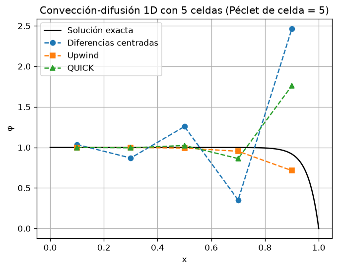
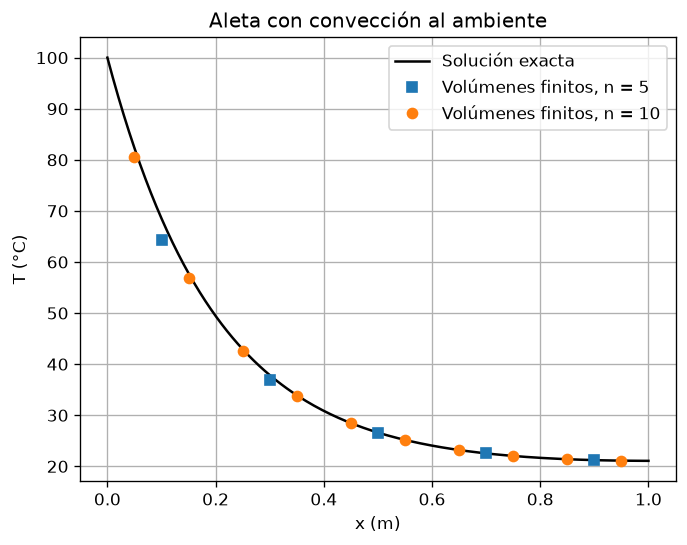
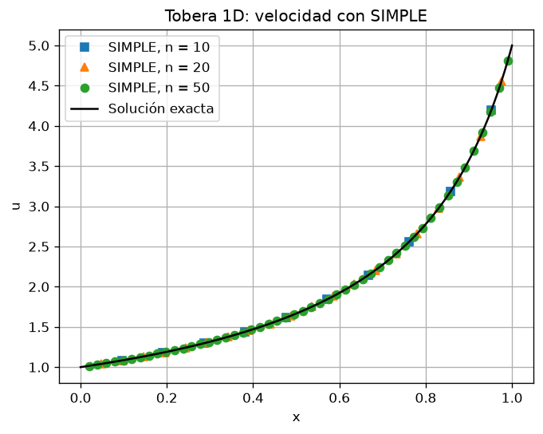
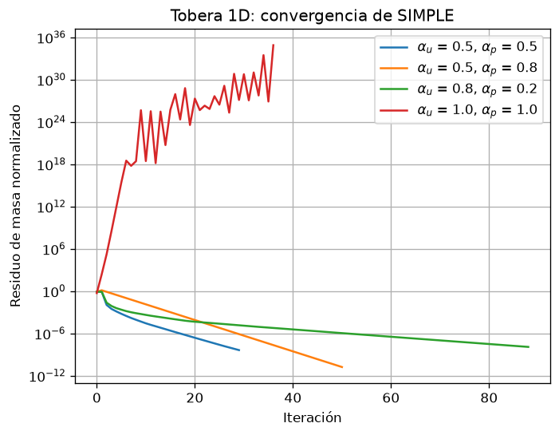

# versteeg-fvm

Implementación propia en Python del método de volúmenes finitos (FVM),
siguiendo el libro *An Introduction to Computational Fluid Dynamics: The
Finite Volume Method*, de Versteeg y Malalasekera. Es un proyecto personal
para entender el CFD por dentro, desde la discretización hasta el
acoplamiento presión-velocidad.

## Contenido

- `fvm/`: paquete reutilizable para la ecuación de transporte en 1D:
  malla centrada en celdas, condiciones de contorno de Dirichlet y
  Neumann, difusión, fuentes linealizadas (con la regla de Patankar
  del coeficiente lineal negativo) y resolvedor TDMA.
- `ejemplos/`: ejemplos del libro, por tema:
  - `difusion/`: conducción estacionaria con y sin fuentes.
  - `conveccion/`: convección-difusión con diferencias centradas,
    upwind, esquema híbrido y QUICK.
  - `SIMPLE/`: algoritmo SIMPLE en una tobera 1D.
  - `transitorio/`: conducción no estacionaria.
- `tests/`: pruebas frente a soluciones exactas.
- `docs/`: documento de diseño del paquete ([diseño](docs/diseno.md)) y
  script que genera las figuras de este README.

## Resultados

### Convección-difusión: comparación de esquemas

Con un número de Péclet de celda alto, las diferencias centradas oscilan
y QUICK se sale del rango físico, mientras que upwind se mantiene acotado
a costa de difusión numérica.

### Aleta con convección al ambiente

Difusión con una fuente linealizada, resuelta con el paquete `fvm`:

### SIMPLE en una tobera 1D

Velocidad numérica frente a la solución exacta con 10, 20 y 50 celdas:

Residuo de masa según los factores de relajación (α_u, α_p): sin
relajación, el algoritmo diverge.

## Uso

Requiere Python 3 con numpy y matplotlib. Desde la raíz del repositorio:

    python -m ejemplos.SIMPLE.tobera1D
    python -m ejemplos.difusion.ejemplo42
    python -m tests.test_difusion
    python -m docs.generar_figuras

## Próximos pasos

- Reorganizar el paquete para que cada término (difusión, convección,
  fuentes) aporte su contribución a la ecuación discreta de forma
  independiente (rama `feat/fvm-conveccion`).
- Migrar los ejemplos antiguos al paquete y añadir QUICK y el término
  transitorio.
- Extender el paquete a 2D.
