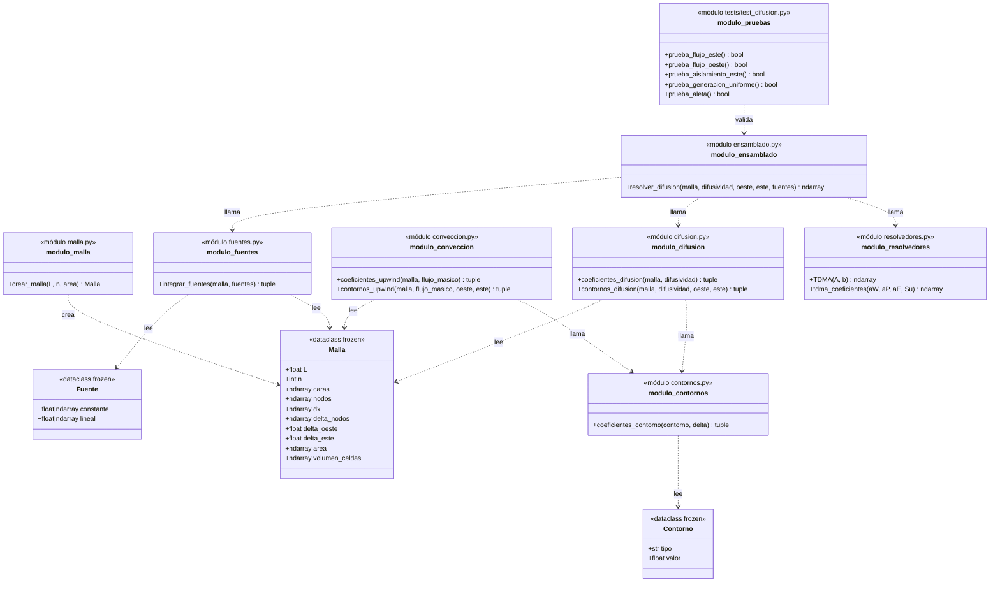
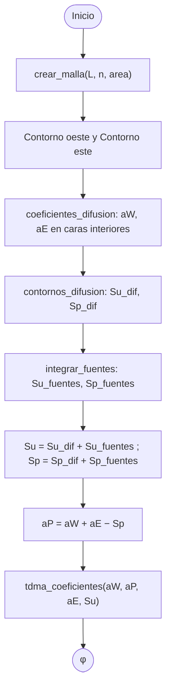
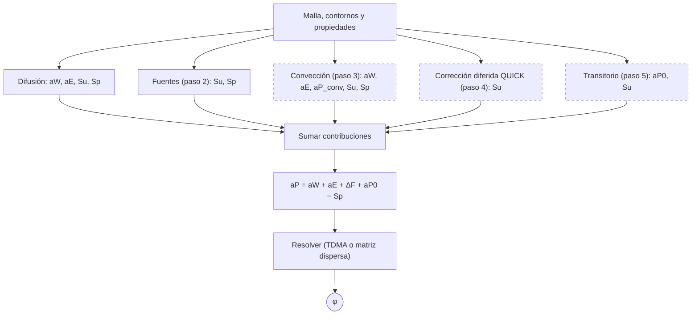

# Diseño de fvm

Paquete de volúmenes finitos (de momento 1D) para la ecuación de transporte de φ,
siguiendo la notación de Versteeg y Malalasekera.

## Estructura del repositorio

- `fvm/`: paquete reutilizable (malla, contornos, difusión, convección, fuentes,
  ensamblado y resolvedores).
- `ejemplos/`: ejemplos del libro, organizados por tema (`difusion`,
  `conveccion`, `SIMPLE`, `transitorio`). Los más antiguos aún no usan
  el paquete y se irán migrando.
- `tests/`: pruebas contra soluciones exactas.
- `docs/`: documentación de diseño.

Todo se ejecuta como módulo desde la raíz, por ejemplo
`python -m ejemplos.difusion.ejemplo42` o `python -m tests.test_difusion`.

## Decisiones

- Las dataclasses (`frozen`) solo guardan datos; las funciones calculan.
- Todas las distancias de la malla se obtienen restando coordenadas.
- Cada contorno se reduce a cuatro coeficientes lineales en φ_P:
  φ_b = α φ_P + β y (∂φ/∂n)_b = γ φ_P + κ, con n la normal saliente.
  El resto del código no necesita saber de qué tipo es el contorno.
- Cada término trata sus propios contornos en su módulo (contornos_difusion,
  contornos_upwind) porque el tratamiento depende del esquema.
- a_P se calcula al final, después de que todos los términos hayan
  aportado sus contribuciones.
- Cada término puede aportar a a_P una parte que no se reduce a aW + aE
  (p. ej. aP_conv = F_e − F_w en convección) y la devuelve por separado;
  el ensamblado la suma junto con las demás.
- Notación: mayúsculas para nodos (aP, aW, aE), minúsculas para caras.
- Fuentes linealizadas por unidad de volumen, S = constante + lineal·φ,
  con lineal <= 0 (regla 3 de Patankar). Se integran con el volumen de
  cada celda, que guarda la malla.
- Cada esquema convectivo tiene sus propias funciones de coeficientes y
  de contornos (coeficientes_upwind, contornos_upwind). Cuando haya un
  segundo esquema, se agruparán en una dataclass o una clase Esquema.

## Diagrama de clases (pasos 1 a 3)

## Diagrama de actividad: resolver_difusion (pasos 1 y 2)

## Ampliación prevista (pasos 2 a 5)

Cada término físico aporta su contribución a los mismos arrays y el
ensamblado solo las suma. Las cajas discontinuas aún no están
conectadas al ensamblado.

## Ideas pendientes

- Contornos de segundo orden (gradiente con tres puntos), comparando
  con el primer orden en un estudio de malla.
- Prueba de convergencia del ejemplo 4.2 frente a la solución exacta.
- Constructores alternativos con @classmethod (p. ej. Malla.uniforme).
- Empaquetar las contribuciones de los coeficientes aE, aW, Su, Sp en 
  su propia dataclass
- Agrupar las propiedades del fluido (densidad, difusividad, viscosidad)
  en una dataclass Propiedades; el flujo másico sigue aparte porque en
  SIMPLE cambia en cada iteración.
- Ensamblado con matriz dispersa (scipy.sparse), necesario en 2D.

