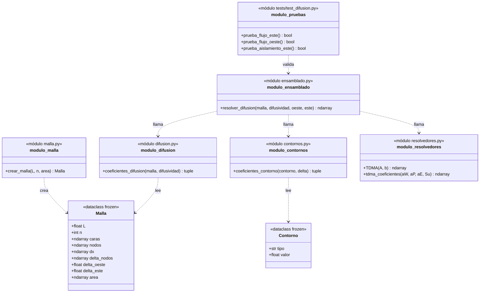
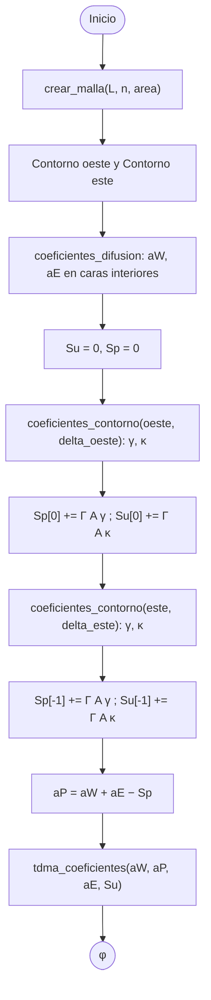
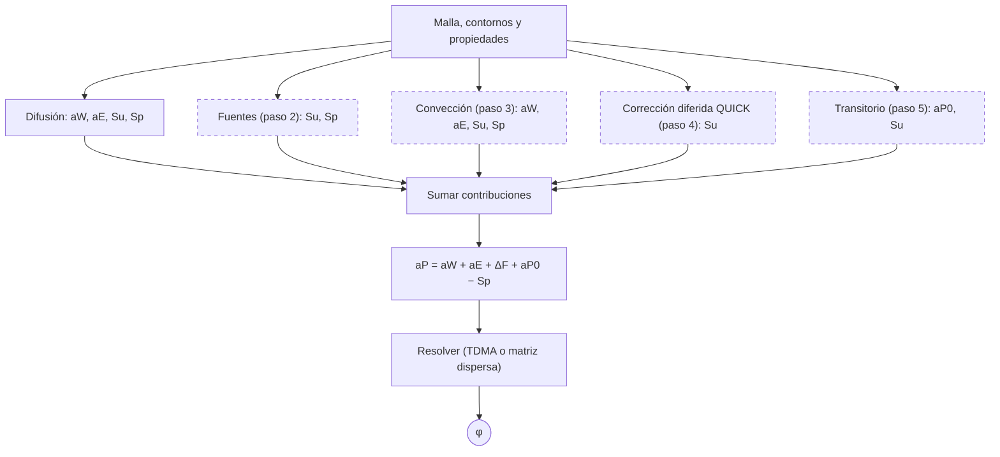

# Diseño de fvm

Paquete de volúmenes finitos (de momento 1D) para la ecuación de transporte de φ,
siguiendo la notación de Versteeg y Malalasekera.

## Estructura del repositorio

- `fvm/`: paquete reutilizable (malla, contornos, difusión, ensamblado
  y resolvedores).
- `ejemplos/`: ejemplos del libro, organizados por tema (`difusion`,
  `conveccion`, `SIMPLE`, `transitorio`). Los más antiguos aún no usan
  el paquete y se irán migrando.
- `tests/`: pruebas contra soluciones exactas.
- `docs/`: documentación de diseño.

Todo se ejecuta como módulo desde la raíz, por ejemplo
`python -m ejemplos.difusion.ejemplo42` o `python -m tests.test_difusion`.

## Decisiones

- Las dataclasses (`frozen`) solo guardan datos; las funciones calculan.
- Todas las distancias de la malla se obtienen restando coordenadas.
- Cada contorno se reduce a cuatro coeficientes lineales en φ_P:
  φ_b = α φ_P + β y (∂φ/∂n)_b = γ φ_P + κ, con n la normal saliente.
  El resto del código no necesita saber de qué tipo es el contorno.
- a_P se calcula al final, después de que todos los términos hayan
  aportado sus contribuciones.
- Notación: mayúsculas para nodos (aP, aW, aE), minúsculas para caras.

## Diagrama de clases (paso 1)

## Diagrama de actividad: resolver_difusion (paso 1)

## Ampliación prevista (pasos 2 a 5)

Cada término físico aporta su contribución a los mismos arrays y el
ensamblado solo las suma. Las cajas discontinuas aún no existen.

